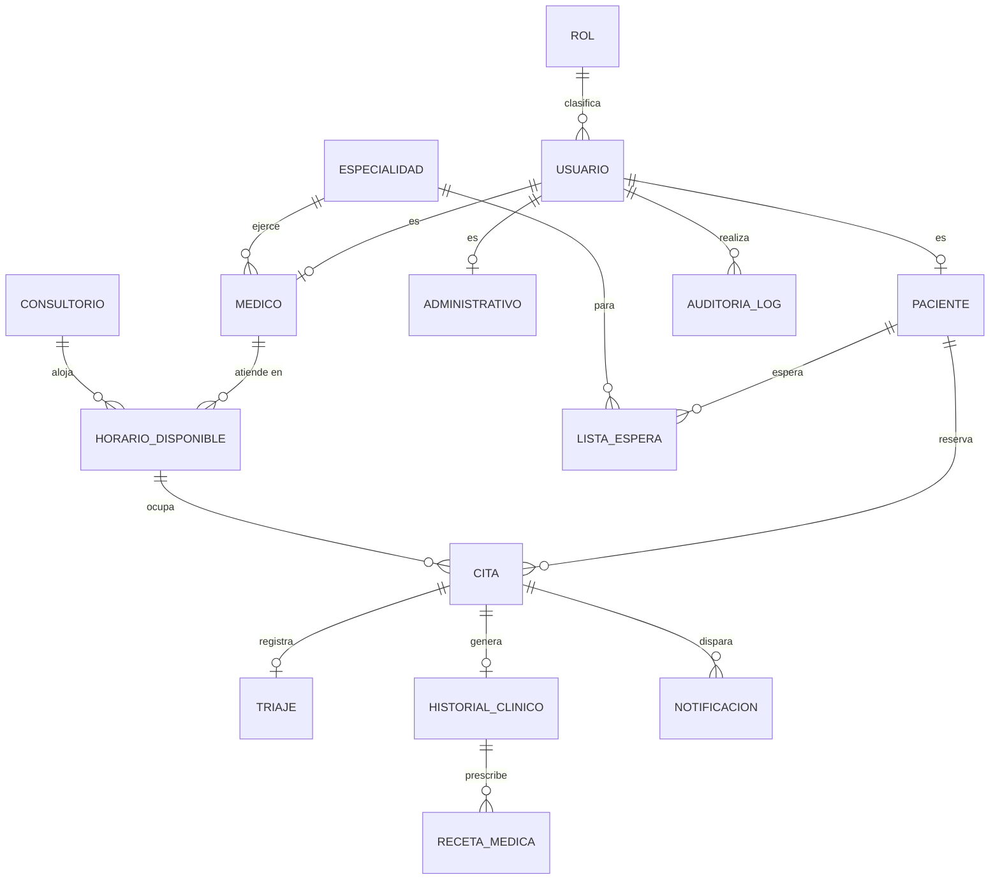

# Análisis y diseño – Sistema de citas, Hospital Hermilio Valdizán

Fuente única: `Integrador_S07.docx` (UTP, Integrador I). Marcas: **[DOC]** dato explícito del documento · **[INFERENCIA DE DISEÑO]** deducido de forma lógica · **[DECISIÓN DE DISEÑO]** elección técnica mía.

## 1. Análisis

### 1.1 Alcance
Aplicación móvil (paciente/apoderado) y módulo web (recepción, médico, administrador) sobre una base de datos centralizada, para consultorios externos de **Psiquiatría y Psicología** con triaje. Cuatro perfiles: PACIENTE, RECEPCIONISTA, MEDICO, ADMINISTRADOR **[DOC]**.

### 1.2 Requisitos funcionales (RF-01 a RF-36) y dónde se cumplen
| RF | Resumen | Implementación |
|---|---|---|
| 01 | Registro de paciente/apoderado en la app | `POST /auth/registro` (`PacienteService.registrar`) |
| 02, 16, 26 | Inicio de sesión (paciente, recepción, médico) | `POST /auth/login` (JWT) |
| 03 | Recuperar contraseña | `/auth/recuperar-password` + `/restablecer-password` (token JWT de un solo uso: huella del hash) |
| 04 | Editar perfil | `PUT /pacientes/me` |
| 05–06 | Consultar especialidades/horarios disponibles | `GET /especialidades`, `GET /horarios` |
| 07 | Reservar cita | `POST /citas` (bloqueo pesimista del horario) |
| 08 / 21 | Reprogramar (paciente / recepción) | `PUT /citas/{id}/reprogramar` |
| 09 / 22 | Cancelar y liberar turno (paciente / recepción) | `PATCH /citas/{id}/cancelar` |
| 10 | Ver mis citas | `GET /citas/mias` |
| 11, 12 | Notificación de confirmación y recordatorio | `NotificacionService`, `RecordatorioScheduler` (idempotente) |
| 13–14 | Consultar detalle y ubicación (pabellón/room) | `GET /citas/{id}` incluye consultorio |
| 15 | Cierre de sesión seguro | `POST /auth/logout` (lista negra del token) |
| 17, 18 | Registrar paciente / buscar por documento | `POST /pacientes`, `GET /pacientes?documento=` |
| 19 | Modificar disponibilidad | `PUT /horarios/{id}` |
| 20 | Cita presencial | `POST /citas/presencial` |
| 23 | Check-in el día de la cita | `PATCH /citas/{id}/check-in` |
| 24 | Lista de espera por especialidad | `/lista-espera` |
| 25, 27 | Agenda diaria (recepción por médico / médico propia) | `GET /citas/agenda`, `/agenda/mia` |
| 28, 29 | Consultar historial / registrar tratamiento | `/historiales` (+ recetas) |
| 30 | Marcar cita atendida | `PATCH /citas/{id}/atender` |
| 31 | Gestión de cuentas y roles | `/usuarios`, `/medicos` |
| 32, 33 | Reportes (atendidas/canceladas/reprogramadas; inasistencia) | `/reportes/citas`, `/reportes/inasistencia` |
| 34 | Configurar especialidades y turnos | `/especialidades`, `/horarios` (turno MANANA/TARDE) |
| 35 | Evitar citas duplicadas | `CitaRepository.existeDuplicada` → 409 |
| 36 | Sincronización móvil/web/BD | Una sola API + BD central (arquitectura) |

### 1.3 Requisitos no funcionales
| RNF | Tratamiento |
|---|---|
| 01 Ley 29733 | Datos mínimos, acceso por rol, auditoría, sin secretos en el código. Cumplimiento legal completo excede al software (consentimientos, políticas). |
| 02 RBAC en historial | `@PreAuthorize` + comprobación de propiedad en servicio |
| 03 Canal cifrado | **Solo configuración/documentación** (HTTPS y `sslMode` en despliegue) |
| 04, 05, 13 MVC, Spring Boot, modular | Capas controller/service/repository/model/dto |
| 06, 12, 18 Conectividad, compatibilidad cliente | Fuera del backend; API REST/JSON estándar |
| 08, 17 Rendimiento/concurrencia | Índices, `JOIN FETCH`, bloqueo pesimista de reserva. **No medido.** |
| 09, 15, 16 Disponibilidad, backup | **Infraestructura, no implementado aquí** |
| 10 Integridad referencial | FKs, UNIQUE, CHECK en `schema.sql` |
| 11 Escalabilidad | Capas y roles extensibles; `Especialidad` como catálogo |
| 14 Trazabilidad clínica | `auditoria_logs` vía `AuditoriaService` |
| 20 Interoperabilidad psiquiatría–psicología–triaje | Triaje y historial ligados a la cita; especialidad como dato |
| 22 Pruebas | 32 pruebas escritas (**no ejecutadas**) |
| 07, 19, 21, 23 Usabilidad, capacitación, indicadores pre/post | Fuera del backend |

### 1.4 Reglas de negocio
1. Un horario admite una sola cita activa; reservar lo marca no disponible; cancelar/reprogramar lo libera de inmediato (RF-09).
2. RF-35: sin dos citas activas del mismo paciente en misma especialidad, fecha y hora.
3. Solo se reservan horarios futuros. **[INFERENCIA]**
4. Reprogramar solo dentro de la misma especialidad. **[INFERENCIA]**
5. Recepción solo reprograma/cancela citas PRESENCIALES (RF-21, RF-22); el paciente solo las suyas.
6. Check-in solo el día de la cita; atender requiere check-in y ser el médico de la cita.
7. Un médico y un consultorio no pueden estar en dos horarios a la vez (UNIQUE + validación de solape). **[INFERENCIA]**
8. Estados de cita: CONFIRMADA → REPROGRAMADA → CHECK_IN → ATENDIDA; CANCELADA; NO_ASISTIO. **[DECISIÓN]**
9. Un horario con cita activa no puede modificarse ni eliminarse; primero se cancela o reprograma la cita. **[DECISIÓN]**

### 1.5 Entidades candidatas → decisión
El documento nombra explícitamente: usuario/rol, paciente (apoderado), recepcionista, médico, administrador, especialidad, horario/turno, cita, lista de espera, triaje, historial clínico electrónico, tratamiento/indicaciones, notificación, consultorio (pabellón/room), auditoría/trazabilidad.
- *Apoderado*: no es entidad; es dato del paciente (`datos_apoderado`). **[DECISIÓN]**
- *Turno*: atributo enum de `horarios_disponibles`, no entidad. **[DECISIÓN]**
- *Recepcionista y administrador* comparten la tabla `administrativos` (con `cargo`), diferenciados por el rol del usuario. **[DECISIÓN]**
- *Tratamiento/indicaciones*: `historiales_clinicos.tratamiento` + `recetas_medicas` (detalle de medicamentos). **[INFERENCIA]**
- *Reprogramación*: contador en la cita (sin tabla de historial, para no superar 15 entidades). **[DECISIÓN]**

Total: **15 entidades** (límite 15): Rol, Usuario, Paciente, Medico, Administrativo, Especialidad, Consultorio, HorarioDisponible, Cita, ListaEspera, Triaje, HistorialClinico, RecetaMedica, Notificacion, AuditoriaLog.

## 2. Modelo conceptual (Mermaid)


## 3. Relaciones N:M y clases intermedias (exactamente 3)
| N:M conceptual | Clase intermedia | Justificación |
|---|---|---|
| Médico ↔ Consultorio | **HorarioDisponible** (+fecha, horas, turno, disponible) | Un médico usa varios consultorios y viceversa, según fecha/hora. RF-05, RF-19, RF-34 |
| Paciente ↔ HorarioDisponible | **Cita** (+estado, origen, reprogramaciones) | RF-07 a RF-09 **[DOC]** |
| Paciente ↔ Especialidad | **ListaEspera** (+fecha, estado) | RF-24 **[DOC]** |

Ninguna se implementa con `@ManyToMany`.

## 4. Modelo lógico (Mermaid)
```mermaid
erDiagram
    roles { BIGINT id_rol PK
            VARCHAR nombre_rol UK }
    usuarios { BIGINT id_usuario PK
               BIGINT id_rol FK
               VARCHAR documento_identidad UK
               VARCHAR nombres
               VARCHAR apellidos
               VARCHAR correo UK
               VARCHAR password_hash
               TINYINT estado }
    pacientes { BIGINT id_paciente PK
                BIGINT id_usuario FK_UK
                VARCHAR tipo_seguro
                VARCHAR telefono_contacto
                VARCHAR datos_apoderado }
    medicos { BIGINT id_medico PK
              BIGINT id_usuario FK_UK
              BIGINT id_especialidad FK
              VARCHAR numero_colegiatura UK }
    administrativos { BIGINT id_administrativo PK
                      BIGINT id_usuario FK_UK
                      VARCHAR cargo }
    especialidades { BIGINT id_especialidad PK
                     VARCHAR nombre_especialidad UK
                     VARCHAR descripcion }
    consultorios { BIGINT id_consultorio PK
                   VARCHAR numero_pabellon
                   VARCHAR codigo_room }
    horarios_disponibles { BIGINT id_horario PK
                           BIGINT id_medico FK
                           BIGINT id_consultorio FK
                           DATE fecha
                           TIME hora_inicio
                           TIME hora_fin
                           VARCHAR turno
                           TINYINT disponible }
    citas { BIGINT id_cita PK
            BIGINT id_paciente FK
            BIGINT id_horario FK
            DATETIME fecha_hora_reserva
            VARCHAR estado
            VARCHAR origen
            INT reprogramaciones }
    lista_espera { BIGINT id_lista_espera PK
                   BIGINT id_paciente FK
                   BIGINT id_especialidad FK
                   DATETIME fecha_registro
                   VARCHAR estado }
    triajes { BIGINT id_triaje PK
              BIGINT id_cita FK_UK
              VARCHAR presion_arterial
              DECIMAL peso
              VARCHAR signos_vitales
              DATETIME fecha_registro }
    historiales_clinicos { BIGINT id_historial PK
                           BIGINT id_cita FK_UK
                           TEXT diagnostico
                           TEXT tratamiento
                           TEXT observaciones
                           DATETIME fecha_registro }
    recetas_medicas { BIGINT id_receta PK
                      BIGINT id_historial FK
                      VARCHAR medicamento
                      VARCHAR dosis
                      VARCHAR indicaciones }
    notificaciones { BIGINT id_notificacion PK
                     BIGINT id_cita FK
                     VARCHAR tipo
                     VARCHAR mensaje
                     DATETIME fecha_envio
                     TINYINT leido }
    auditoria_logs { BIGINT id_log PK
                     BIGINT id_usuario FK
                     VARCHAR accion
                     DATETIME fecha_hora }
    roles ||--o{ usuarios : ""
    usuarios ||--o| pacientes : ""
    usuarios ||--o| medicos : ""
    usuarios ||--o| administrativos : ""
    especialidades ||--o{ medicos : ""
    medicos ||--o{ horarios_disponibles : ""
    consultorios ||--o{ horarios_disponibles : ""
    pacientes ||--o{ citas : ""
    horarios_disponibles ||--o{ citas : ""
    pacientes ||--o{ lista_espera : ""
    especialidades ||--o{ lista_espera : ""
    citas ||--o| triajes : ""
    citas ||--o| historiales_clinicos : ""
    historiales_clinicos ||--o{ recetas_medicas : ""
    citas ||--o{ notificaciones : ""
    usuarios ||--o{ auditoria_logs : ""
```

## 5. Modelo físico (MySQL)
El DDL completo e idempotente está en `src/main/resources/schema.sql` (InnoDB, utf8mb4) y los datos base en `data.sql` (4 roles y las 2 especialidades del alcance; **sin usuarios ni contraseñas**). Puntos clave:
- Integridad: FKs `ON DELETE RESTRICT` (salvo `recetas_medicas` CASCADE y `auditoria_logs` SET NULL), UNIQUE (documento, correo, colegiatura, `(médico,fecha,hora)`, `(consultorio,fecha,hora)`, un triaje e historial por cita) y CHECK de estados/turnos.
- **[DECISIÓN]** No existe UNIQUE en `citas(id_horario)`, porque una cita cancelada libera el horario y puede reservarse de nuevo; la exclusividad la garantiza el bloqueo pesimista sobre `horarios_disponibles`.
- **[DECISIÓN]** RF-35 se valida en servicio (MySQL no permite índice único parcial por estado).

## 6. Lista de validación (previa al código)
| Verificación | Resultado |
|---|---|
| Entidades ≤ 15 | ✅ 15 |
| Exactamente 3 intermedias | ✅ HorarioDisponible, Cita, ListaEspera |
| Sin entidades inventadas | ✅ cada una trazada al documento (ver 1.5) |
| Sin `@ManyToMany` | ✅ |
| Cada RF con destino | ✅ tabla 1.2 |
| Sin secretos en código/config | ✅ |
| Diagramas coherentes con DDL y entidades | ✅ contrastado con script propio (`check_schema.py`) |

## 7. Decisiones técnicas relevantes
- Spring Security + JWT (el perfil del proyecto pide autenticación por roles); jjwt 0.12.6.
- Relaciones `LAZY`; DTOs como `record`; el mapeo a DTO ocurre dentro de la transacción.
- `CascadeType.ALL` solo en `HistorialClinico → RecetaMedica` (composición real, con `orphanRemoval`).
- Auditoría con `@Transactional` simple (no `readOnly`) porque inserta.
- `spring.jpa.hibernate.ddl-auto=none`: el esquema lo gobierna `schema.sql`.
- Notificaciones: se persisten y se entregan mediante `NotificadorCorreo` (implementación de log; punto de extensión para SMTP/SMS/push).

## 8. Limitaciones conocidas y honestas
1. `mvn` no se pudo ejecutar en el entorno de desarrollo: **compilación real, pruebas y arranque contra MySQL sin verificar**.
2. Lista negra de tokens en memoria (una sola instancia).
3. Enlace de recuperación: el token se entrega al notificador (log); falta el front-end que lo consuma.
4. RNF de infraestructura (03 cifrado en tránsito, 09, 15, 16) y de medición (08, 17, 23) no son verificables desde este código.

## 9. Auditoría de consistencia final
| Comprobación | Resultado |
|---|---|
| Tablas `schema.sql` = entidades JPA = 15 | ✅ contraste automatizado |
| Endpoints del README = controladores | ✅ revisados contra `@RequestMapping` |
| Pruebas escritas compilan contra stubs de las APIs | ✅ |
| Pruebas ejecutadas | ❌ **no ejecutadas** |
| Contraseñas/secretos hardcodeados | ✅ ninguno (`DB_PASSWORD`, `JWT_SECRET` sin valor por defecto) |
| 32 pruebas: 5 JPA + 13 reglas de cita + 14 HTTP/seguridad | ✅ escritas |

## 10. Tabla de control
| Tarea | Estado |
|---|---|
| Análisis (RF, RNF, reglas, entidades, marcas) | ✅ |
| Modelos conceptual, lógico y físico + Mermaid | ✅ |
| Validación previa (≤15 entidades, 3 intermedias) | ✅ |
| `schema.sql` y `data.sql` | ✅ escritos; ❌ no ejecutados en MySQL |
| Entidades JPA, repositorios, servicios, DTOs, controladores | ✅ escritos |
| `@RestControllerAdvice` | ✅ |
| `application.properties` con variables de entorno | ✅ |
| `pom.xml` con dependencias justificadas | ✅ |
| Pruebas mínimas | ✅ escritas · ❌ no ejecutadas |
| Compilación con Maven | ❌ no realizada (Maven Central inaccesible) |
| README y estructura final | ✅ |
| Auditoría de consistencia | ✅ (con las limitaciones de la sección 8) |
